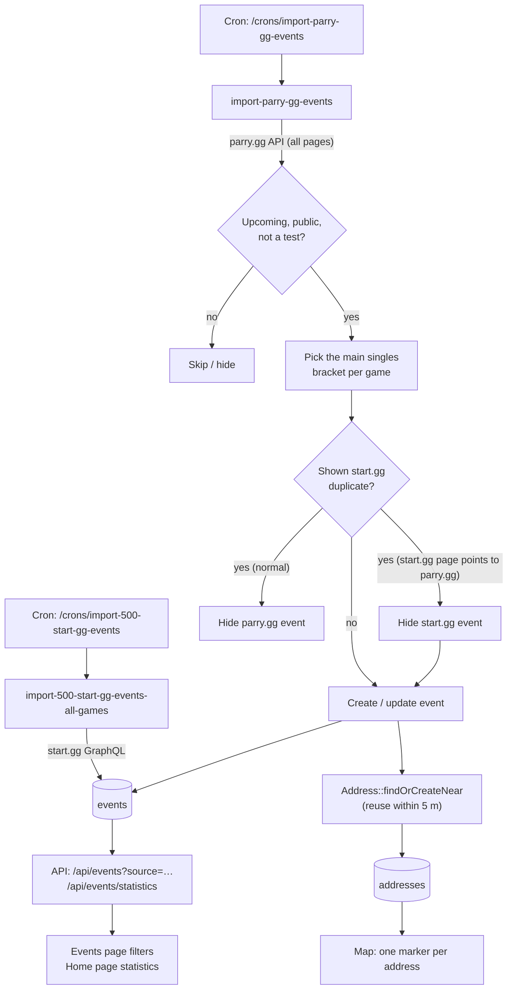

# parry.gg integration

Smash Map imports upcoming events from two sources: **start.gg** and **parry.gg**. This page gives an overview of how the parry.gg import works and what changed around it. For the API improvements suggested to the parry.gg team, see [parry-gg-integration-requests.md](parry-gg-integration-requests.md).

## Import flow

## The parry.gg import

`php artisan import-parry-gg-events` (add `-v` for skip statistics, `--all` to update every event).

- Reads every page of `TournamentService/GetTournaments` with the `PARRY_GG_API_KEY` key (`config/services.php`).
- Creates **one event per tournament and game**, named after the tournament, like the start.gg import. Events are identified by `parry_gg_id` (the tournament id) and `game_id`.
- **Singles only:** the biggest event named as singles ("Melee Singles", "1v1", "Melee"), otherwise the biggest event that is not doubles, teams or a side bracket (amateur, redemption, ladder…).
- **Skipped:** past, test and non-public tournaments, and games Smash Map doesn't list. Tournaments without an end date (sent as `1970-01-01`) are treated as one-day events.
- **Links** point to the tournament page: `https://parry.gg/{slug}`.
- **Notifications:** the same follow, time and distance notifications as start.gg events.

### start.gg duplicates

A parry.gg event is a duplicate when a **shown** start.gg event of the same game starts within a day and has almost the same name (with the same numbers) or is within 500 m.

- Normally the start.gg event is kept and the parry.gg one is hidden.
- If the start.gg page only points to parry.gg (its name mentions parry), the start.gg event is hidden instead.
- Hiding a start.gg event by hand makes the parry.gg event show again at the next import.

## Addresses

The map shows one marker per address. Addresses used to be matched by exact coordinates, which never matched (MySQL and PHP round doubles differently), so each import created a new address for the same venue. Markers then stacked and hid each other's events.

- `Address::findOrCreateNear()` reuses the closest address within 5 m. It is used by both imports, registration and settings.
- `distanceToKM()` now uses the haversine formula; the previous formula returned `NaN` for identical points.
- `php artisan merge-duplicate-addresses [--dry-run]` merges the existing duplicates (events and users are moved to one address per place).

## Website

- **Events page:** a source filter (All sources / start.gg / parry.gg, `?source=start_gg|parry_gg` in the API). The filter store was rewritten around one helper, which fixed the country filter getting stuck and the name search not going back to page 1. In-person events without an address show "Location TBA".
- **Home page statistics:** tiles (upcoming events with the source split, countries, registered players), events per game, players per game and events in the next 6 months. Monthly numbers now take the year into account.

## Commands and cron routes

| Command | Cron route | Imports |
|---|---|---|
| `import-500-start-gg-events-all-games` | `/crons/import-500-start-gg-events` | start.gg, 500 events per game |
| `import-parry-gg-events` | `/crons/import-parry-gg-events` | parry.gg, every upcoming tournament |
| `delete-events` | `/crons/delete-events` | Deletes past events, hidden ones included |
| `merge-duplicate-addresses` | – | Run manually once after deploying |

`refresh-events-preserve-following` re-imports both sources and restores the follows of start.gg and parry.gg events.

## Deploying

1. Run the migration adding `parry_gg_id` and `parry_gg_updated_at` to `events`.
2. Set `PARRY_GG_API_KEY` in `.env`.
3. Point the cron to `/crons/import-500-start-gg-events` (the old `/crons/import-500-events` route was removed) and add `/crons/import-parry-gg-events`.
4. Run `php artisan merge-duplicate-addresses --dry-run`, then without `--dry-run`.
